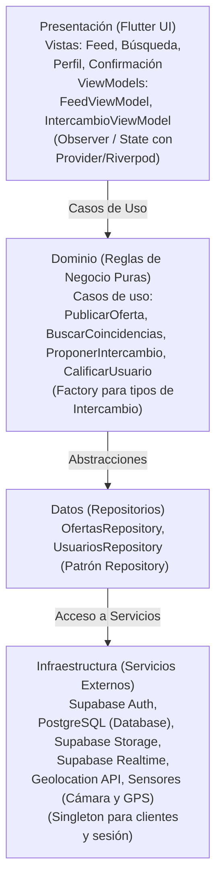

# Swappia 
> *"Lo que tú tienes, alguien más lo necesita."*

Aplicación móvil de trueque e intercambio de servicios y bienes entre vecinos de una misma colonia o comunidad en **Dolores Hidalgo, C.I.N., Guanajuato**.

---

## Datos Institucionales y Equipo

* **Institución:** Universidad Tecnológica del Norte de Guanajuato ([UTNG](https://www.utng.edu.mx/))
* **Área:** Tecnologías de la Información — Ingeniería en Desarrollo y Gestión de Software
* **Materia:** Desarrollo Móvil Integral (Unidad de aprendizaje: *Definición del proceso de desarrollo móvil*)
* **Profesor:** Barrientos Avalos José de Jesús Eduardo
* **Grupo:** GIDS6101-E

### Integrantes del Equipo
| Nombre | Matrícula |
| :--- | :--- |
| **Aguayo Santana Carlos Samael** | `1223100396` |
| **Loredo Melendez José de Jesús** | `1223100429` |
| **Pardo Zamarripa Juan Diego** | `1223100425` |

---

## Planteamiento del Problema y Propuesta de Valor

### El Problema
En colonias y comunidades semi-rurales cercanas a Dolores Hidalgo existen tres fricciones principales:
1. **Falta de visibilidad de oficios locales:** Personas con oficios (electricistas, costureras, quienes hacen mandados, artesanos de talavera/cerámica) dependen exclusivamente del boca en boca y carecen de un canal digital accesible para darse a conocer en su entorno inmediato.
2. **Desperdicio de bienes útiles:** Existen productos y bienes en buen estado sin usar porque venderlos tradicionalmente implica negociar con desconocidos o plataformas impersonales.
3. **Comercio informal basado en confianza:** El comercio informal y tianguis operan sobre la confianza vecinal, pero sin una herramienta digital comunitaria que respalde acuerdos ni reputación.

### La Solución: Swappia
Swappia digitaliza y potencia la confianza vecinal a través de un canal hiperlocal que permite:
* Crear un **perfil vecinal único** para publicar *"Lo que ofrezco"* y *"Lo que busco"*.
* **Emparejamiento geolocalizado** dentro del radio de la colonia o comunidad mediante consultas espaciales en PostgreSQL.
* **Modalidad de pago flexible:** Trueque puro, dinero en efectivo o combinación mixta.
* **Reputación vecinal:** Sistema de calificaciones entre vecinos reales para fomentar la seguridad y confianza comunitaria.

---

## Alcance del Proyecto & Funcionalidades

### MVP (Producto Mínimo Viable — Indispensable)
- [x] **Inicialización y configuración base de arquitectura por capas.**
- [ ] **Registro e inicio de sesión** (Supabase Auth - perfil vecino).
- [ ] **Publicar oferta o necesidad** (Servicios u oficios y bienes materiales con fotos y descripción).
- [ ] **Búsqueda y filtros hiperlocales** por colonia/comunidad y categorías.
- [ ] **Proponer intercambio:** Selección de tipo de acuerdo (dinero, trueque o mixto).
- [ ] **Confirmación del intercambio.**
- [ ] **Calificar tras el intercambio** (reputación vecinal).

### Roadmap Futuro
- [ ] Sistema de puntos *"Manzanas"* para trueques indirectos y acumulativos.
- [ ] Chat en tiempo real integrado con Supabase Realtime.
- [ ] Notificaciones push de oportunidades cercanas.
- [ ] Verificación de identidad avanzada de vecinos.
- [ ] Integración con comercios y artesanos locales registrados.

---

## SPRINT 1

### Entrega 1.1: Documentacion Formal y Arquitectura del Proyecto
* **Responsable:** **Aguayo Santana Carlos Samael** (`1223100396`)
* **Descripcion de la tarea:** Documentacion formal del planteamiento del problema en colonias de Dolores Hidalgo, propuesta de valor, stack tecnologico, estrategias de Git/Commits y diagramas de arquitectura en Mermaid.
* **Tareas Realizadas:**
  - [x] Redaccion de datos institucionales y de integrantes.
  - [x] Planteamiento del problema y definicion de funcionalidades del MVP.
  - [x] Inclusion de diagrama de flujo y arquitectura MVVM con sintaxis Mermaid.
* **Criterios de Aceptacion Verificados:**
  - [x] README.md estructurado y renderizando visualmente de forma correcta en GitHub.

### Entrega 1.2: Dominio y Contratos de Repositorio del Perfil Vecinal
* **Responsable:** **Loredo Melendez Jose de Jesus** (`1223100429`)
* **Objetivo:** Definir las entidades puras de negocio y los contratos de repositorio para los datos del perfil del vecino (nombre, colonia/comunidad, telefono, calificacion acumulada), asegurando que la capa de dominio permanezca 100% independiente de librerias externas y de la infraestructura de persistencia (Supabase).
* **Tareas Realizadas:**
  1. **Entidad de Negocio (`UserEntity`)** en `lib/domain/models/user_entity.dart`:
     - Modela la informacion del vecino: identificador (`id`), nombre (`nombre`), colonia o comunidad (`coloniaComunidad`), telefono (`telefono`), reputacion (`calificacionAcumulada`), cantidad de evaluaciones (`totalCalificaciones`), fotografia (`fotoUrl`) y fecha de registro (`fechaRegistro`).
     - Reglas de negocio puras: validacion de nombre, formato de telefono mexicano (10 digitos), verificacion de perfil completo, confiabilidad vecinal y reputacion comunitaria.
     - Inmutabilidad y metodos de valor (`copyWith`, `operator ==`, `hashCode`).
  2. **Contrato de Repositorio (`UserRepository`)** en `lib/domain/repositories/user_repository.dart`:
     - Interfaz abstracta que define las operaciones del ciclo de vida del perfil del vecino (`getUserById`, `getCurrentUser`, `createUser`, `updateUser`, `getUsersByColonia` y `updateRating`).
  3. **Mappers y Modelo de Datos (`UserModel`)** en `lib/data/models/user_model.dart`:
     - Modelo para persistencia en PostgreSQL / Supabase (convencion snake_case) y mappers bidireccionales (`toEntity` y `fromEntity`).
  4. **Pruebas Unitarias** en `test/user_test.dart`:
     - Cobertura de validaciones de dominio, contrato de repositorio y serializacion JSON.

---

## SPRINT 2

### feat(ui): Sistema de diseno, tema global y UI Kit responsivo
* **Responsable:** **Aguayo Santana Carlos Samael** (`1223100396`)
* **Objetivo:** Disenar el tema visual de Swappia definiendo colores institucionales (arcilla/terracota alfarera de Dolores Hidalgo y verde intercambio comunitario), fuentes, bordes redondeados y componentes atomicos reutilizables (`CustomButton`, `CustomTextField`) en `lib/core/theme/` y `lib/presentation/widgets/`.

#### Tareas Realizadas:
- [x] **Definicion de Tokens de Color (`AppColors`)** en `lib/core/theme/app_colors.dart`:
  - Paleta institucional basada en identidad local: Primario terracota (`#C84B31`), secundario verde intercambio (`#2E7D32`), terciario ambar (`#D97706`).
  - Tokens semanticos y adaptativos para superficies, textos, bordes y fondos de inputs tanto en modo claro (`lightBackground`, `lightSurface`) como en modo oscuro (`darkBackground`, `darkSurface`).
- [x] **Configuracion Centralizada del Tema (`AppTheme`)** en `lib/core/theme/app_theme.dart`:
  - Implementacion con **Material 3** (`useMaterial3: true`).
  - Soporte completo para `lightTheme` y `darkTheme`.
  - Estilizacion integral de `ColorScheme`, `AppBarTheme`, `ElevatedButtonTheme`, `OutlinedButtonTheme`, `TextButtonTheme`, `InputDecorationTheme`, `CardTheme` y `DividerTheme`.
- [x] **Diseno de Widget Reutilizable `CustomButton`** en `lib/presentation/widgets/custom_button.dart`:
  - 5 variantes de diseno: `primary`, `secondary`, `outlined`, `tonal` y `text`.
  - Escala de tamanos: `small` (38px), `medium` (50px), `large` (56px).
  - Estado de carga integrado (`isLoading: true`) con `CircularProgressIndicator` centrado que previene pulsaciones repetidas sin alterar el layout.
  - Soporte de icono lider o trailer, ancho responsivo (`isFullWidth`) y accesibilidad mediante `Semantics`.
- [x] **Diseno de Widget Reutilizable `CustomTextField`** en `lib/presentation/widgets/custom_text_field.dart`:
  - Entrada de texto con bordes estilizados, etiquetas superiores (`label`), textos de sugerencia (`hint`) y ayuda (`helperText`).
  - Modo contrasena interactivo (`isPassword: true`) con alternancia de visibilidad mediante icono de ojo.
  - Soporte multilinea para descripciones de oficios/trueques, prefijos, sufijos y validadores de formulario (`validator`).
- [x] **Pantalla Demostrativa de UI Kit** en `lib/main.dart`:
  - Demostrador interactivo con toggle dinamico entre Tema Claro y Tema Oscuro.
- [x] **Suite de Pruebas de Widgets** en `test/ui_kit_test.dart`:
  - 9 pruebas automatizadas verificando consistencia en modo claro/oscuro, disparo de callbacks, estados de carga, toggle de contrasena y validacion.

#### Criterios de Aceptacion Verificados:
- [x] **Todos los componentes responden al tema oscuro/claro y mantienen consistencia visual.**
- [x] **Validacion de linter superada con cero errores (`flutter analyze` = No issues found).**
- [x] **100% de pruebas unitarias y de widgets aprobadas (`flutter test`).**

---

## Arquitectura de Software

El proyecto implementa una arquitectura **MVVM (Model - View - ViewModel) estructurada por capas**, garantizando separación de responsabilidades, reactividad en tiempo real y facilidad de pruebas.

### Capas del Sistema
1. **Presentación (`lib/presentation/`):** Vistas (`screens`/`views`), componentes reutilizables (`widgets`) y `viewmodels` que gestionan el estado y reaccionan ante cambios.
2. **Dominio (`lib/domain/`):** Entidades de negocio, contratos/interfaces de repositorios y casos de uso (`usecases`) independientes de librerías externas.
3. **Datos (`lib/data/`):** Implementación de los repositorios y fuentes de datos remotas (`SupabaseDataSource`) y locales (`HiveDataSource`).
4. **Infraestructura / Core (`lib/core/`):** Configuración del cliente Supabase, manejo de errores, utilidades de geolocalización/sensores y constantes.

---

## Patrones de Diseño Implementados

* **Repository:** Desacopla la lógica de negocio de Supabase y PostgreSQL, permitiendo cambiar o complementar la persistencia (ej. caché offline con Hive) sin tocar la interfaz ni el dominio.
* **Observer / State:** Mantiene la UI sincronizada reactivamente con el ViewModel mediante listeners o streams en tiempo real (Supabase Realtime).
* **Factory:** Centraliza la creación flexible de instancias de `Intercambio` según su tipo (`Dinero`, `Trueque` o `Mixto`).
* **Singleton:** Gestiona una única instancia global del cliente de Supabase (`Supabase.instance.client`) y la sesión del usuario autenticado.

---

## Stack Tecnológico

| Área | Tecnologías |
| :--- | :--- |
| **Frontend Móvil** | [Flutter](https://flutter.dev/) + [Dart](https://dart.dev/) |
| **Backend & Base de Datos** | [Supabase](https://supabase.com/) ([PostgreSQL](https://www.postgresql.org/) relacional + soporte geoespacial) |
| **Autenticación** | Supabase Auth (Email / Teléfono / Contraseña) |
| **Almacenamiento Multimedia** | Supabase Storage (Fotos de artículos, oficios y avatares) |
| **Sincronización en Tiempo Real** | Supabase Realtime (WebSockets para cambios en acuerdos y feed) |
| **Persistencia Local / Offline** | [Hive](https://pub.dev/packages/hive) (Caché local rápido) |
| **Geolocalización & Sensores**| Geolocator / Google Maps API, Image Picker (Cámara), GPS |
| **Gestión de Estado** | Provider / Riverpod |
| **Diseño & Prototipado** | Figma |
| **Metodología y Gestión** | Scrum (Sprints de 1-2 semanas), GitHub Projects, Kanban |

---

## Flujo de Trabajo y Versionamiento (Git)

Se utiliza una estrategia de ramificación basada en Gitflow simplificado:
* `main`: Código estable y listo para entrega/producción.
* `develop`: Rama principal de integración y desarrollo activo.
* `feature/<nombre-funcionalidad>`: Ramas de características específicas creadas a partir de `develop`.

### Convención de Commits (Conventional Commits)
Los mensajes de commit deben ser descriptivos y seguir el formato:
* `feat:` Nueva funcionalidad para el usuario.
* `fix:` Corrección de algún error o bug.
* `docs:` Cambios exclusivamente en documentación (ej. `README.md`).
* `refactor:` Reestructuración de código sin alterar su comportamiento externo.
* `test:` Adición o corrección de pruebas unitarias o de widgets.
* `chore:` Tareas de mantenimiento, dependencias o configuración del proyecto.

---

## Estrategia de Pruebas

* **Unitarias:** Validación aislada de los casos de uso, lógica de emparejamiento, cálculo de reputación y ViewModels mediante mocks.
* **Widgets / UI:** Verificación del comportamiento visual de formularios, validaciones de campos y vistas de listas/búsqueda.
* **Integración:** Comprobación del flujo completo: `Publicar oferta -> Buscar en colonia -> Proponer intercambio -> Confirmar -> Calificar`.
* **Pruebas de Usuario (Piloto):** Validación con vecinos reales en 2 o 3 colonias piloto de Dolores Hidalgo.

---
