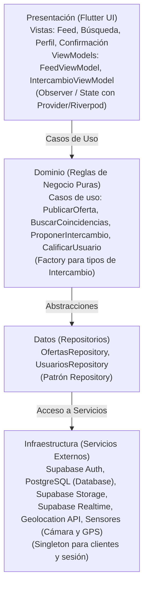

# Swappia 
> *"Lo que tú tienes, alguien más lo necesita."*

Aplicación móvil de trueque e intercambio de servicios y bienes entre vecinos de una misma colonia o comunidad en **Dolores Hidalgo, C.I.N., Guanajuato**.

---

## Datos Institucionales y Equipo

* **Institución:** Universidad Tecnológica del Norte de Guanajuato ([UTNG](https://www.utng.edu.mx/))
* **Área:** Tecnologías de la Información — Ingeniería en Desarrollo y Gestión de Software
* **Materia:** Desarrollo Móvil Integral (Unidad de aprendizaje: *Definición del proceso de desarrollo móvil*)
* **Profesor:** Barrientos Avalos José de Jesús Eduardo
* **Grupo:** GIDS6101-E

### Integrantes del Equipo
| Nombre | Matrícula |
| :--- | :--- |
| **Aguayo Santana Carlos Samael** | `1223100396` |
| **Loredo Melendez José de Jesús** | `1223100429` |
| **Pardo Zamarripa Juan Diego** | `1223100425` |

---

## Planteamiento del Problema y Propuesta de Valor

### El Problema
En colonias y comunidades semi-rurales cercanas a Dolores Hidalgo existen tres fricciones principales:
1. **Falta de visibilidad de oficios locales:** Personas con oficios (electricistas, costureras, quienes hacen mandados, artesanos de talavera/cerámica) dependen exclusivamente del boca en boca y carecen de un canal digital accesible para darse a conocer en su entorno inmediato.
2. **Desperdicio de bienes útiles:** Existen productos y bienes en buen estado sin usar porque venderlos tradicionalmente implica negociar con desconocidos o plataformas impersonales.
3. **Comercio informal basado en confianza:** El comercio informal y tianguis operan sobre la confianza vecinal, pero sin una herramienta digital comunitaria que respalde acuerdos ni reputación.

### La Solución: Swappia
Swappia digitaliza y potencia la confianza vecinal a través de un canal hiperlocal que permite:
* Crear un **perfil vecinal único** para publicar *"Lo que ofrezco"* y *"Lo que busco"*.
* **Emparejamiento geolocalizado** dentro del radio de la colonia o comunidad mediante consultas espaciales en PostgreSQL.
* **Modalidad de pago flexible:** Trueque puro, dinero en efectivo o combinación mixta.
* **Reputación vecinal:** Sistema de calificaciones entre vecinos reales para fomentar la seguridad y confianza comunitaria.

---

## Alcance del Proyecto & Funcionalidades

### MVP (Producto Mínimo Viable — Indispensable)
- [x] **Inicialización y configuración base de arquitectura por capas.**
- [x] **Registro e inicio de sesión** (Supabase Auth - perfil vecino).
- [ ] **Publicar oferta o necesidad** (Servicios u oficios y bienes materiales con fotos y descripción).
- [ ] **Búsqueda y filtros hiperlocales** por colonia/comunidad y categorías.
- [ ] **Proponer intercambio:** Selección de tipo de acuerdo (dinero, trueque o mixto).
- [ ] **Confirmación del intercambio.**
- [ ] **Calificar tras el intercambio** (reputación vecinal).

### Roadmap Futuro
- [ ] Sistema de puntos *"Manzanas"* para trueques indirectos y acumulativos.
- [ ] Chat en tiempo real integrado con Supabase Realtime.
- [ ] Notificaciones push de oportunidades cercanas.
- [ ] Verificación de identidad avanzada de vecinos.
- [ ] Integración con comercios y artesanos locales registrados.

---

## 🏃 SPRINT 1

### Entrega 1.1: Documentación Formal y Arquitectura del Proyecto
* **Responsable:** **Aguayo Santana Carlos Samael** (1223100396)
* **Descripción de la tarea:** Documentación formal del planteamiento del problema en colonias de Dolores Hidalgo, propuesta de valor, stack tecnológico, estrategias de Git/Commits y diagramas de arquitectura en Mermaid.
* **Tareas Realizadas:**
  - [x] Redacción de datos institucionales y de integrantes.
  - [x] Planteamiento del problema y definición de funcionalidades del MVP.
  - [x] Inclusión de diagrama de flujo y arquitectura MVVM con sintaxis Mermaid.
* **Criterios de Aceptación Verificados:**
  - [x] README.md estructurado y renderizando visualmente de forma correcta en GitHub.

### Entrega 1.2: Dominio y Contratos de Repositorio del Perfil Vecinal
* **Responsable:** **Loredo Melendez José de Jesús** (1223100429)
* **Objetivo:** Definir las entidades puras de negocio y los contratos de repositorio para los datos del perfil del vecino (nombre, colonia/comunidad, teléfono, calificación acumulada), asegurando que la capa de dominio permanezca 100% independiente de librerías externas y de la infraestructura de persistencia (Supabase).
* **Tareas Realizadas:**
  1. **Entidad de Negocio (UserEntity)** en lib/domain/models/user_entity.dart:
     - Modela la información del vecino: identificador (id), nombre (
ombre), colonia o comunidad (coloniaComunidad), teléfono (	elefono), reputación (calificacionAcumulada), cantidad de evaluaciones (	otalCalificaciones), fotografía (otoUrl) y fecha de registro (echaRegistro).
     - Reglas de negocio puras: validación de nombre, formato de teléfono mexicano (10 dígitos), verificación de perfil completo, determinación de confiabilidad vecinal y formateo de reputación comunitaria.
     - Inmutabilidad y métodos de valor (copyWith, operator ==, hashCode).
  2. **Contrato de Repositorio (UserRepository)** en lib/domain/repositories/user_repository.dart:
     - Interfaz abstracta que define las operaciones del ciclo de vida del perfil del vecino (getUserById, getCurrentUser, createUser, updateUser, getUsersByColonia y updateRating) sin acoplamiento a servicios externos.
  3. **Mappers y Modelo de Datos (UserModel)** en lib/data/models/user_model.dart:
     - Representación de datos para la capa de persistencia compatible con PostgreSQL y Supabase (convención snake_case).
     - Mappers bidireccionales 	oEntity() y UserModel.fromEntity(...) para desacoplar el dominio del esquema de datos.
  4. **Pruebas Unitarias** en 	est/user_test.dart:
     - Cobertura de validaciones de negocio en UserEntity, verificación del contrato UserRepository y testeo de mappers/serialización JSON.

---

## 🏃 SPRINT 2

### Entrega 2.1: Cliente Singleton de Supabase y Configuración de .env (Issue [#6](https://github.com/utng-sdp/swappia/issues/6))
* **Responsable:** **Pardo Zamarripa Juan Diego** (1223100425)
* **Objetivo:** Implementar el cliente Singleton para gestionar la conexión global con Supabase mediante variables de entorno seguras (SUPABASE_URL y SUPABASE_ANON_KEY).
* **Tareas Realizadas:**
  1. **Soporte para variables de entorno (lutter_dotenv)**:
     - Integración de lutter_dotenv en pubspec.yaml y declaración en la sección ssets: - .env.
     - Protección de credenciales sensibles agregando .env al .gitignore.
     - Archivo plantilla .env.example con variables de referencia (SUPABASE_URL, SUPABASE_ANON_KEY).
  2. **Cliente Singleton de Supabase (SupabaseService)** en lib/core/services/supabase_service.dart:
     - Implementación del patrón **Singleton** (constructor privado _internal, constructor actory y getter estático instance).
     - Getters utilitarios para cliente (client), autenticación (uth) y usuario (currentUser).
     - Normalización y validación defensiva de SUPABASE_URL y SUPABASE_ANON_KEY.
  3. **Inicialización asíncrona en el arranque** en lib/main.dart:
     - Carga segura de variables de entorno con dotenv.load() e inicialización de la conexión de Supabase antes de ejecutar 
unApp().
  4. **Pruebas Unitarias** en 	est/supabase_service_test.dart:
     - Pruebas del patrón Singleton y verificación de conexión con cliente simulado.

### Entrega 2.2: Sistema de Diseño, Tema Global y UI Kit Responsivo (eat(ui))
* **Responsable:** **Aguayo Santana Carlos Samael** (1223100396)
* **Objetivo:** Diseñar el tema visual de Swappia definiendo colores institucionales (arcilla/terracota de Dolores Hidalgo y verde intercambio comunitario), fuentes, bordes redondeados y componentes atómicos reutilizables (CustomButton, CustomTextField) en lib/core/theme/ y lib/presentation/widgets/.
* **Tareas Realizadas:**
  1. **Tokens de Color (AppColors)** en lib/core/theme/app_colors.dart:
     - Paleta identitaria: Primario terracota (#C84B31), secundario verde trueque (#2E7D32), terciario ámbar (#D97706).
     - Tokens adaptativos para superficies, textos, bordes y fondos en tema claro y oscuro.
  2. **Configuración Centralizada del Tema (AppTheme)** en lib/core/theme/app_theme.dart:
     - Implementación completa de **Material 3** (useMaterial3: true) para lightTheme y darkTheme.
     - Estilización central de botones, inputs, AppBar, tarjetas y divisores.
  3. **Componente Reutilizable CustomButton** en lib/presentation/widgets/custom_button.dart:
     - Variantes primary, secondary, outlined, 	onal y 	ext.
     - Tamaños small, medium y large.
     - Estado de carga isLoading con spinner integrado accesible sin alterar dimensiones.
  4. **Componente Reutilizable CustomTextField** en lib/presentation/widgets/custom_text_field.dart:
     - Modo contraseña interactivo con toggle de visibilidad (isPassword: true).
     - Soporte para etiquetas, sugerencias, iconos, textos de error y multilínea.
  5. **Pantalla Demostrativa y Pruebas**:
     - Catálogo interactivo de componentes en lib/main.dart.
     - 9 pruebas automatizadas en 	est/ui_kit_test.dart aprobadas al 100%.

#### Criterios de Aceptación Verificados:
- [x] **Todos los componentes responden al tema oscuro/claro y mantienen consistencia visual.**
- [x] **100% de pruebas unitarias y de widgets aprobadas (flutter test).**
- [x] **Validación de linter superada con cero errores (flutter analyze = No issues found).**

### Entrega 2.3: Gestión de Estado, Reactividad y Flujo de Autenticación (`feat(auth)`)
* **Responsable:** **Loredo Melendez José de Jesús** (1223100429)
* **Objetivo:** Desarrollar el flujo interactivo de autenticación conectando ViewModel con la interfaz visual, gestionando estados asíncronos y persistiendo la sesión de forma reactiva hacia el Feed principal.
* **Tareas Realizadas:**
  1. **Casos de Uso de Autenticación** en `lib/domain/usecases/`:
     - Implementación de `LoginUseCase`, `RegisterUseCase` y `GetSessionUseCase`.
  2. **ViewModel y Manejo de Estado (`AuthViewModel`)** en `lib/presentation/viewmodels/auth_viewmodel.dart`:
     - Estados `initial`, `loading`, `authenticated`, `unauthenticated` y `error`.
     - Métodos reactivos para `login`, `register`, `logout` y `checkSession`.
  3. **Vistas de Autenticación y Navegación**:
     - `LoginView` y `RegisterView` con validaciones de formulario completas.
     - Redirección automática y fluida al `FeedView` al autenticarse.

### Entrega 2.4: Pantallas de Inicio de Sesión y Registro de Vecino (Issue [#10](https://github.com/utng-sdp/swappia/issues/10))
* **Responsable:** **Aguayo Santana Carlos Samael** (1223100396)
* **Objetivo:** Construir las vistas de usuario para el inicio de sesión (LoginView) y registro (RegisterView), incluyendo selección de colonia/comunidad dentro de Dolores Hidalgo, validadores de formulario y manejo visual de estados (loading spinner, banners de error).
* **Tareas Realizadas:**
  - [x] **Constantes de Dolores Hidalgo (DoloresHidalgoConstants)** en `lib/core/constants/dolores_hidalgo_constants.dart`:
    - Catálogo centralizado de colonias urbanas y comunidades rurales de Dolores Hidalgo, C.I.N.
  - [x] **Banner de Estado Reutilizable (StatusBanner)** en `lib/presentation/widgets/status_banner.dart`:
    - Componente adaptable para alertas de error, éxito, advertencia e información con cierre interactivo y adaptación a modo oscuro/claro.
  - [x] **Pantalla de Inicio de Sesión (LoginView)** en `lib/presentation/views/auth/login_view.dart`:
    - Formulario con validación de correo electrónico y contraseña.
    - Manejo de estados: indicador de carga en CustomButton, banner de error y enlace a recuperación.
    - Enlace responsivo hacia la pantalla de registro de vecino.
  - [x] **Pantalla de Registro de Vecino (RegisterView)** en `lib/presentation/views/auth/register_view.dart`:
    - Formulario con nombre completo, teléfono mexicano (10 dígitos sincronizado con reglas de UserEntity), correo electrónico y campo opcional de oficio/bien.
    - Dropdown interactivo para selección obligatoria de colonia o comunidad de Dolores Hidalgo.
    - Validación de contraseña con confirmación coincidente.
    - Manejo de estados de carga y errores mediante StatusBanner.
  - [x] **Integración y Flujo de Navegación** en `lib/main.dart`:
    - AuthNavigationWrapper con animación suave (AnimatedSwitcher) y alternancia de tema claro/oscuro.
  - [x] **Suite de Pruebas de Vistas de Autenticación** en `test/auth_views_test.dart`:
    - 8 pruebas de widgets verificando renderizado, validación de formularios, dropdown y callbacks de navegación.

### Entrega 2.5: Data Source Remoto con Supabase Auth y Persistencia en PostgreSQL (Issue [#9](https://github.com/utng-sdp/swappia/issues/9))
* **Responsable:** **Pardo Zamarripa Juan Diego** (1223100425)
* **Objetivo:** Desarrollar la fuente de datos remota y la implementación del repositorio de autenticación para interactuar con la API de Supabase Auth, persistiendo los datos complementarios del vecino en PostgreSQL.
* **Tareas Realizadas:**
  1. **Migración DDL para la tabla `profiles` en PostgreSQL** en `supabase/migrations/20261020_create_profiles.sql`:
     - Definición de la tabla `profiles` vinculada a `auth.users(id)` con clave foránea en cascada (`ON DELETE CASCADE`).
     - Campos para `nombre`, `colonia_comunidad`, `telefono`, reputación (`calificacion_acumulada`, `total_calificaciones`), `foto_url` y `fecha_registro`.
     - Habilitación de **Row Level Security (RLS)** con políticas específicas para lectura comunitaria autenticada, inserción de perfil propio y actualización restringida al propietario.
     - Disparador (`trigger`) y función `handle_new_user()` para auto-población de perfiles a partir de metadatos de registro.
  2. **Data Source Remoto (`SupabaseAuthRemoteDataSource`)** en `lib/data/datasources/remote/supabase_auth_remote_datasource.dart`:
     - Implementación del contrato `AuthRemoteDataSource`.
     - Implementación de métodos específicos `signUpWithEmail` y `signInWithEmail`.
     - Persistencia y sincronización automática de datos del perfil vecinal mediante `.from('profiles').upsert(...)`.
     - Mapeo y traducción amigable de excepciones de Supabase Auth (`AuthException`) al español.
     - Métodos auxiliares `fetchCurrentUser` y `signOut`.
  3. **Ampliación del Contrato `AuthRemoteDataSource`** en `lib/data/datasources/remote/auth_remote_datasource.dart`:
     - Exposición de métodos `signInWithEmail`, `signUpWithEmail` y `signOut` en la interfaz base y en `MockAuthRemoteDataSource`.
  4. **Conexión en el arranque de la aplicación** en `lib/main.dart`:
     - Detección reactiva de inicialización de Supabase con inyección dinámica de `SupabaseAuthRemoteDataSource` o fallback seguro para pruebas locales.
  5. **Pruebas Unitarias Automatizadas** en `test/supabase_auth_remote_datasource_test.dart`:
     - Verificación de cumplimiento del contrato `AuthRemoteDataSource`.
     - Pruebas de deserialización e integridad con `UserModel` y `UserEntity`.
     - Validación del 100% de la suite de pruebas del proyecto (40 tests aprobados).

#### Criterios de Aceptación Verificados (Issue #9):
- [x] **Un usuario puede registrarse e iniciar sesión de forma remota persistiendo en PostgreSQL.**
- [x] **Tabla `profiles` definida con restricciones de integridad, RLS y triggers de sincronización.**
- [x] **Cero errores de análisis estático (`flutter analyze = No issues found`).**
- [x] **Total de pruebas unitarias y de widgets aprobadas al 100% (`flutter test`).**

### Entrega 2.6: Formulario interactivo "Publicar Oferta o Necesidad" (Issue [#13](https://github.com/utng-sdp/swappia/issues/13))
* **Responsable:** **Aguayo Santana Carlos Samael** (1223100396)
* **Objetivo:** Diseñar la pantalla `CreateOfferView` que permite al vecino seleccionar si ofrece o busca un servicio/bien, adjuntar fotos de la cámara/galería con previsualización en tiempo real y clasificarlo en categorías de Dolores Hidalgo.

#### Tareas Realizadas:
- [x] **Selector Toggle Interactivo (Ofrezco / Busco)** en `lib/presentation/views/exchange/create_offer_view.dart`:
  - Alternancia dinámica entre modalidad de ofrecer servicio/bien (`AppColors.secondary` verde trueque) y buscar necesidad (`AppColors.primary` terracota), sincronizando los textos de acción y botones.
- [x] **Selector de Categorías Especializadas**:
  - Dropdown interactivo con iconos temáticos para las categorías clave de Dolores Hidalgo: `Electricidad`, `Costura`, `Mandados`, `Artesanía` y `Bienes` (junto con el catálogo comunitario), con validación obligatoria.
- [x] **Integración de Plugin `image_picker` y Previsualización Multimedia**:
  - Captura y selección de fotografía desde cámara (`ImageSource.camera`) o galería (`ImageSource.gallery`).
  - Tarjeta de previsualización con thumbnail adaptativo (`Image.file` / `kIsWeb`) y acción para eliminar o reemplazar la foto antes de publicar.
- [x] **Conexión con la Capa de Presentación y Dominio**:
  - Integración reactiva con `CreateOfferViewModel` para el envío asíncrono, persistencia de foto y limpieza automática del formulario tras confirmación.
- [x] **Suite de Pruebas de Widgets Aprobada al 100%** en `test/create_offer_view_test.dart`:
  - 5 pruebas exhaustivas verificando renderizado, toggle reactivo, previsualización/eliminación de foto con `image_picker`, validaciones y publicación exitosa.

#### Criterios de Aceptación Verificados (Issue #13):
- [x] **Formulario permite previsualizar la foto tomada y seleccionar la categoría antes de enviar.**
- [x] **Vistas adaptables y responsivas con manejo visual de estados (loading spinner, banners de error y éxito).**
- [x] **100% de la suite de pruebas del proyecto aprobada (62 pruebas pasando en `flutter test`).**
- [x] **Cero errores ni advertencias de análisis estático (`dart analyze = No issues found!`).**

---

## Arquitectura de Software

El proyecto implementa una arquitectura **MVVM (Model - View - ViewModel) estructurada por capas**, garantizando separación de responsabilidades, reactividad en tiempo real y facilidad de pruebas.



### Capas del Sistema
1. **Presentación (`lib/presentation/`):** Vistas (`screens`/`views`), componentes reutilizables (`widgets`) y `viewmodels` que gestionan el estado y reaccionan ante cambios.
2. **Dominio (`lib/domain/`):** Entidades de negocio, contratos/interfaces de repositorios y casos de uso (`usecases`) independientes de librerías externas.
3. **Datos (`lib/data/`):** Implementación de los repositorios y fuentes de datos remotas (`SupabaseDataSource`) y locales (`HiveDataSource`).
4. **Infraestructura / Core (`lib/core/`):** Configuración del cliente Supabase, manejo de errores, utilidades de geolocalización/sensores y constantes.

---

## Patrones de Diseño Implementados

* **Repository:** Desacopla la lógica de negocio de Supabase y PostgreSQL, permitiendo cambiar o complementar la persistencia (ej. caché offline con Hive) sin tocar la interfaz ni el dominio.
* **Observer / State:** Mantiene la UI sincronizada reactivamente con el ViewModel mediante listeners o streams en tiempo real (Supabase Realtime).
* **Factory:** Centraliza la creación flexible de instancias de `Intercambio` según su tipo (`Dinero`, `Trueque` o `Mixto`).
* **Singleton:** Gestiona una única instancia global del cliente de Supabase (`Supabase.instance.client`) y la sesión del usuario autenticado.

---

## Stack Tecnológico

| Área | Tecnologías |
| :--- | :--- |
| **Frontend Móvil** | [Flutter](https://flutter.dev/) + [Dart](https://dart.dev/) |
| **Backend & Base de Datos** | [Supabase](https://supabase.com/) ([PostgreSQL](https://www.postgresql.org/) relacional + soporte geoespacial) |
| **Autenticación** | Supabase Auth (Email / Teléfono / Contraseña) |
| **Almacenamiento Multimedia** | Supabase Storage (Fotos de artículos, oficios y avatares) |
| **Sincronización en Tiempo Real** | Supabase Realtime (WebSockets para cambios en acuerdos y feed) |
| **Persistencia Local / Offline** | [Hive](https://pub.dev/packages/hive) (Caché local rápido) |
| **Geolocalización & Sensores**| Geolocator / Google Maps API, Image Picker (Cámara), GPS |
| **Gestión de Estado** | Provider / Riverpod |
| **Diseño & Prototipado** | Figma |
| **Metodología y Gestión** | Scrum (Sprints de 1-2 semanas), GitHub Projects, Kanban |

---

## Flujo de Trabajo y Versionamiento (Git)

Se utiliza una estrategia de ramificación basada en Gitflow simplificado:
* `main`: Código estable y listo para entrega/producción.
* `develop`: Rama principal de integración y desarrollo activo.
* `feature/<nombre-funcionalidad>`: Ramas de características específicas creadas a partir de `develop`.

### Convención de Commits (Conventional Commits)
Los mensajes de commit deben ser descriptivos y seguir el formato:
* `feat:` Nueva funcionalidad para el usuario.
* `fix:` Corrección de algún error o bug.
* `docs:` Cambios exclusivamente en documentación (ej. `README.md`).
* `refactor:` Reestructuración de código sin alterar su comportamiento externo.
* `test:` Adición o corrección de pruebas unitarias o de widgets.
* `chore:` Tareas de mantenimiento, dependencias o configuración del proyecto.

---

## Estrategia de Pruebas

* **Unitarias:** Validación aislada de los casos de uso, lógica de emparejamiento, cálculo de reputación y ViewModels mediante mocks.
* **Widgets / UI:** Verificación del comportamiento visual de formularios, validaciones de campos y vistas de listas/búsqueda.
* **Integración:** Comprobación del flujo completo: `Publicar oferta -> Buscar en colonia -> Proponer intercambio -> Confirmar -> Calificar`.
* **Pruebas de Usuario (Piloto):** Validación con vecinos reales en 2 o 3 colonias piloto de Dolores Hidalgo.

---

## 💻 Instalación y Configuración Local

### Prerrequisitos
* [Flutter SDK](https://docs.flutter.dev/get-started/install) (versión compatible con Dart SDK `^3.0.0`).
* Dispositivo físico Android (con depuración USB habilitada) o emulador de Android Studio.
* Proyecto en [Supabase](https://supabase.com/) con credenciales de API (`SUPABASE_URL` y `SUPABASE_ANON_KEY`).

### Pasos para ejecutar
1. **Clonar el repositorio:**
   ```bash
   git clone https://github.com/utng-sdp/swappia.git
   cd swappia
   ```

2. **Instalar dependencias:**
   ```bash
   flutter pub get
   ```

3. **Configurar variables de entorno:**
   Copiar la plantilla `.env.example` y crear el archivo `.env` en la raíz con las credenciales de Supabase:
   ```env
   SUPABASE_URL=https://tu-proyecto.supabase.co
   SUPABASE_ANON_KEY=tu-anon-key-de-supabase
   ```

4. **Ejecutar pruebas unitarias:**
   ```bash
   flutter test
   ```

5. **Ejecutar en modo de desarrollo:**
   ```bash
   flutter run
   ```

